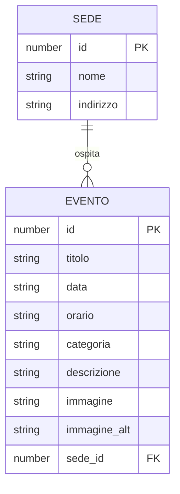

# Schema dei dati (`dati/SCHEMA.md`)
## 1. Entità

Il modello dei dati si basa su due entità principali, memorizzate in file separati:
* **Evento** (`dati/eventi.json`): rappresenta i singoli appuntamenti in programma (incontri, laboratori, mostre).
* **Sede** (`dati/sedi.json`): rappresenta i luoghi fisici della città in cui si svolgono gli eventi.

---

## 2. Campi delle entità

### Evento (`dati/eventi.json`)

| Campo | Tipo | Descrizione | Esempio |
| :--- | :--- | :--- | :--- |
| `id` | `number` (intero) | Identificativo univoco dell'evento | `1` |
| `titolo` | `string` | Titolo dell'appuntamento | `"Lettere in movimento"` |
| `data` | `string` (ISO 8601) | Data di svolgimento (`YYYY-MM-DD`) | `"2026-06-12"` |
| `orario` | `string` | Orario di inizio (`HH:MM`) | `"10:00"` |
| `categoria` | `string` | Tipologia dell'evento (`Incontro`, `Laboratorio`, `Mostra`) | `"Incontro"` |
| `descrizione` | `string` | Breve testo descrittivo dei contenuti | `"Come cambia un messaggio quando cambiano le lettere?..."` |
| `immagine` | `string` (percorso) | Percorso relativo dell'illustrazione associata | `"assets/lettere-in-movimento.svg"` |
| `immagine_alt` | `string` | Testo alternativo per l'accessibilità dell'immagine | `"Lettere geometriche disposte su una griglia"` |
| `sede_id` | `number` (intero) | Riferimento all'`id` della sede ospitante | `1` |

### Sede (`dati/sedi.json`)

| Campo | Tipo | Descrizione | Esempio |
| :--- | :--- | :--- | :--- |
| `id` | `number` (intero) | Identificativo univoco della sede | `1` |
| `nome` | `string` | Denominazione della sede | `"Officina Nord — Sede centrale"` |
| `indirizzo` | `string` | Indirizzo fisico completo | `"Corso Duca degli Abruzzi 24, Torino"` |

---

## 3. Chiavi primarie

* **Evento**: il campo `id` è la chiave primaria. È un numero intero positivo, univoco all'interno di `eventi.json` e stabile nel tempo (non viene riassegnato se un evento viene modificato o rimosso).
* **Sede**: il campo `id` è la chiave primaria. È un numero intero positivo, univoco all'interno di `sedi.json` e stabile nel tempo.

---

## 4. Relazioni tra entità

Una sede può ospitare più eventi, mentre ogni singolo evento si svolge in una sola sede, collegata tramite il riferimento `Evento.sede_id` a `Sede.id`.

---

## 5. Quantità dei record

Attualmente l'archivio contiene:
* **6 eventi** (con `id` da `1` a `6`, distribuiti su due giornate: 12 e 13 giugno 2026).
* **3 sedi** (con `id` da `1` a `3`, situate a Torino: Officina Nord, Spazio Forma e Cortile Comune).

---

## 6. Aggiornamento e pubblicazione dei dati

* **Chi aggiorna i dati**: i curatori e i manutentori del progetto che hanno accesso in scrittura alla repository.
* **Come avviene l'aggiornamento**: i file `dati/eventi.json` e `dati/sedi.json` vengono modificati direttamente nella repository (assicurandosi di mantenere valida la sintassi JSON e coerenti i riferimenti `sede_id`). Una volta salvate le modifiche e caricate sul ramo principale (*commit* e *push*), la piattaforma di hosting attiva automaticamente la rigenerazione e la pubblicazione del sito aggiornato.

---

## 7. Che cosa mostra la pagina

La pagina legge entrambi i file JSON e incrocia i dati tramite `sede_id` per presentare il programma completo della rassegna. Per ciascuno dei sei eventi vengono mostrati:
* L'illustrazione grafica (`immagine`) corredata dal relativo testo alternativo (`immagine_alt`).
* Il titolo, la categoria di appartenenza e la descrizione dell'attività.
* La data e l'orario di inizio.
* Il nome e l'indirizzo della sede ospitante, recuperati dinamicamente da `sedi.json`.